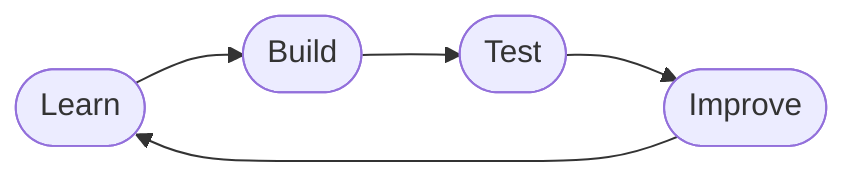

<div align="center">


### `TECH ENTHUSIAST` · `BUILDER` · `PROBLEM SOLVER`


<br/>


<br/><br/>

<a href="https://github.com/mujuks?tab=repositories">

</a>
<a href="https://github.com/mujuks">

</a>
<a href="https://instagram.com/maxmjuxs">

</a>

</div>


## ◈ `01` — About Me

```js
const mj = {
  name: "MJ",
  roles: ["Builder", "Tinkerer", "Problem Solver"],
  focus: ["Web Dev", "IT & Networking", "Security Systems", "Trading Tech"],
  currentlyLearning: "JavaScript, one project at a time",
  funFact: "I can wire an intercom AND code a trading indicator",
  motto: "Curiosity starts the journey. Consistency builds the results."
};
```

I'm **MJ**, and I love technology and the ways it solves real-world problems. My interests span software development, computer systems, networking, security solutions, and trading technology. I enjoy turning what I learn into practical projects.

<div align="center">

| Area | What I'm doing |
|:--|:--|
| **Development** | Exploring programming and web development |
| **IT Support** | Sharpening troubleshooting and diagnostics skills |
| **Networking** | Learning networking and internet technologies |
| **Security** | Diving into CCTV, intercoms, and access control |
| **Trading** | Building indicators with TradingView and Pine Script |

</div>

> *Curiosity starts the journey. Consistency builds the results.*


## ◈ `02` — Tech Stack

<div align="center">

**PROGRAMMING & WEB**


**DEVELOPMENT TOOLS**


**IT · NETWORKING · SECURITY**


**TRADING TECHNOLOGY**


</div>


## ◈ `03` — What I'm Building Toward

<table>
<tr>
<td width="50%" valign="top">

### Web Development

Building responsive websites and useful web apps that people actually enjoy using.

</td>
<td width="50%" valign="top">

### Programming

Leveling up JavaScript, logical thinking, and problem-solving.

</td>
</tr>
<tr>
<td width="50%" valign="top">

### IT & Networking

Mastering diagnostics, connectivity, and network fundamentals.

</td>
<td width="50%" valign="top">

### Security Technology

Designing and understanding CCTV, video intercoms, and access control.

</td>
</tr>
<tr>
<td width="50%" valign="top">

### Trading Tools

Crafting and backtesting custom indicators in Pine Script.

</td>
<td width="50%" valign="top">

### Automation

Eliminating repetitive tasks and building smoother workflows.

</td>
</tr>
</table>


## ◈ `04` — Projects & Experiments

<div align="center">

<a href="https://github.com/mujuks?tab=repositories">

</a>
<a href="https://github.com/mujuks?tab=repositories">

</a>
<a href="https://github.com/mujuks?tab=repositories">

</a>
<a href="https://github.com/mujuks?tab=repositories">

</a>

</div>

<br/>

I want to create projects that are useful, understandable, and built with a purpose.

**[Browse my repositories →](https://github.com/mujuks?tab=repositories)**


## ◈ `05` — GitHub Dashboard

<div align="center">

<a href="https://github.com/mujuks">

</a>
<a href="https://github.com/mujuks">

</a>


<br/>


</div>


## ◈ `06` — The Mindset

```text
LEARN       → Stay curious.
BUILD       → Turn ideas into projects.
TEST        → Learn from what works and what doesn't.
IMPROVE     → Make the next version better.
REPEAT      → Keep growing.
```



I believe the best way to improve is to keep learning, build consistently, and stay open to new ideas.


## ◈ `07` — Let's Connect

<div align="center">

### Have an idea? Let's build something meaningful.

I'm open to exchanging ideas, learning with other developers, and exploring technology projects.

<br/>

<a href="https://github.com/mujuks">

</a>
<a href="https://instagram.com/maxmjuxs">

</a>

<br/><br/>


**BUILD WITH PURPOSE. KEEP EXPLORING. NEVER STOP LEARNING.**

<sub>Thanks for stopping by</sub>

</div>
